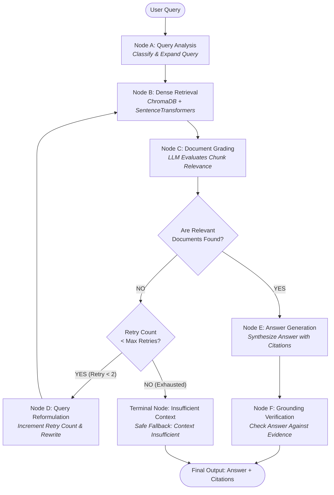
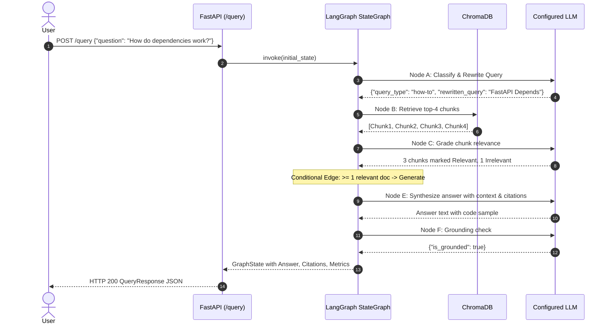

# RAG-Based Technical Documentation Assistant

An enterprise-ready **Self-Corrective Retrieval-Augmented Generation (RAG) System** built with **LangGraph StateGraph**, **FastAPI**, **ChromaDB**, and **Sentence Transformers**. Designed to accurately answer complex technical queries using a domain corpus (FastAPI documentation), self-evaluate retrieved chunk relevance, automatically reformulate unsuccessful queries, generate grounded answers with source citations, and expose functionality via REST APIs and an interactive Streamlit UI.

---

## 1. Project Title & Overview

**RAG Technical Documentation Assistant** is an intelligent assistant designed to query technical documentation corpora. Unlike standard naive RAG pipelines that suffer from hallucination, retrieval failure, and off-topic synthesis, this assistant implements a **Self-Corrective StateGraph workflow**:
1. **Query Analysis**: Categorizes questions and expands them for dense semantic retrieval.
2. **Dense Vector Retrieval**: Queries persistent ChromaDB vector storage via Sentence Transformers (`all-MiniLM-L6-v2`).
3. **Relevance Grading**: Grades each retrieved chunk with an LLM or deterministic fallback, filtering out irrelevant context.
4. **Self-Correction & Adaptive Retry Loop**: If initial retrieval fails to yield relevant chunks, reformulates the search query and re-queries the vector store up to a strictly bounded retry limit.
5. **Grounded Generation & Citation Tracking**: Synthesizes concise answers strictly supported by the retrieved evidence and appends verified citations with document titles, sections, and official URLs.
6. **Grounding Verification**: Performs an automated factual consistency check comparing the generated answer against the context.
7. **Production API & UI**: Exposes OpenAPI REST endpoints with SSRF guards, SQLite feedback collection, health diagnostics, and a Streamlit frontend.

---

## 2. Problem Statement

Standard RAG architectures often fail in production technical environments due to:
- **Retrieval Noise**: Irrelevant documentation chunks dilute context, leading LLMs to answer incorrectly.
- **Query Misalignment**: User questions phrased colloquially fail to match technical nomenclature in indexed documentation.
- **Hallucinations & Ungrounded Claims**: Models invent methods or parameters not documented in the reference text.
- **Infinite Loops & Cost Explosion**: Unguarded retry logic can loop continuously or consume unbounded API credits.
- **Security Vulnerabilities**: Dynamic URL ingestion endpoints without SSRF defenses can expose internal network resources or cloud metadata endpoints (`169.254.169.254`).

This project solves these issues through a formal **LangGraph StateGraph** state machine with conditional routing, bounded retry limits, relevance filtering, factual grounding checks, and enterprise security protections.

---

## 3. Features & Assignment Requirements Addressed

| Requirement | Implementation Detail | Status |
| :--- | :--- | :--- |
| **LangGraph StateGraph** | Genuine `langgraph.graph.StateGraph` with 7 nodes, typed state, and conditional edges | ✅ Completed |
| **FastAPI REST API** | `/query`, `/ingest`, `/documents`, `/feedback`, `/health`, and `/` | ✅ Completed |
| **Vector Database** | Persistent ChromaDB with collection deduplication and update replacement | ✅ Completed |
| **Local Embeddings** | Lightweight `sentence-transformers` (`all-MiniLM-L6-v2`) locally run | ✅ Completed |
| **LLM Provider Abstraction** | Google Gemini (`langchain-google-genai`), OpenAI (`langchain-openai`), and offline `DeterministicMockLLM` | ✅ Completed |
| **Self-Corrective Retry** | Adaptive query expansion with loop-prevention counters and insufficient-context fallback | ✅ Completed |
| **Grounded Citations** | Document title, section heading, source filename, chunk index, and canonical URL | ✅ Completed |
| **Corpus & Ingestion** | 5 comprehensive FastAPI technical documents, directory ingester, file uploader, SSRF-safe URL ingester | ✅ Completed |
| **Security & SSRF Protection** | Private IP rejection (RFC 1918), loopback filtering, link-local metadata protection, safe redirect validation | ✅ Completed |
| **Feedback Persistence** | SQLite database logging query IDs, ratings (`thumbs_up`/`thumbs_down`), and comments | ✅ Completed |
| **Automated Testing** | 33 comprehensive Pytest unit and integration tests covering all requirements | ✅ Completed (100% Pass) |
| **Streamlit Interface** | Interactive frontend communicating with the real FastAPI backend | ✅ Completed |

---

## 4. Architecture Diagram



---

## 5. LangGraph Nodes & Conditional Routing Explanation

### Node A: Query Analysis (`query_analysis_node`)
- Analyzes user questions about FastAPI documentation.
- Classifies query type: `conceptual`, `how-to`, `troubleshooting`, or `api_reference`.
- Expands query keywords to maximize dense cosine similarity with markdown headers and technical code snippets.

### Node B: Retrieval (`retrieval_node`)
- Searches the persistent ChromaDB collection (`fastapi_docs`).
- Extracts top-$k$ chunks (default: $k=4$) using Sentence Transformers embeddings.
- Attaches similarity scores and preserves metadata (filename, title, section, url, chunk index).

### Node C: Document Grading (`document_grading_node`)
- Iterates over retrieved chunks and prompts the LLM to grade whether the chunk contains relevant evidence.
- Filters out irrelevant documents. Only chunks confirmed as relevant pass to answer generation.

### Node D: Query Rewriting / Retry (`query_retry_node`)
- Triggered when 0 retrieved chunks pass the relevance grading stage.
- Reformulates the search query with alternative technical terminology and synonyms.
- **Loop Prevention**: Strictly increments `retry_count`. Prevents infinite loops.

### Node E: Answer Generation (`generate_answer_node`)
- Synthesizes a factual, technical answer using **only** the validated relevant context chunks.
- Assembles structured `citations` linking back to the exact document title, section heading, filename, and official documentation URL.

### Node F: Grounding Verification (`grounding_check_node`)
- Validates that the generated assertions and code samples are supported by the retrieved context snippets.
- Sets `grounding_status` to `"grounded"`, `"ungrounded"`, or `"insufficient_evidence"`.

### Fallback Node: Insufficient Context (`insufficient_context_node`)
- Reached when `retry_count >= maximum_retries` with zero relevant documents found.
- Returns a safe, honest response without hallucinations: *"The documentation corpus does not contain sufficient information to answer your question after multiple search attempts."*

---

## 6. Data Flow: Ingestion to Answer Generation



---

## 7. Folder Structure

```
rag-documentation-assistant/
├── app/
│   ├── __init__.py
│   ├── config.py                 # Pydantic Settings & environment variable configuration
│   ├── schemas.py                # Pydantic request/response validation schemas
│   ├── main.py                   # FastAPI application, CORS, routers, and lifecycle
│   ├── rag/
│   │   ├── __init__.py
│   │   ├── state.py              # TypedDict GraphState & initial state factory
│   │   ├── prompts.py            # System prompts for analysis, grading, retry, and answering
│   │   ├── llm.py                # Provider abstraction: Gemini, OpenAI, DeterministicMockLLM
│   │   ├── ingestion.py          # Section-aware chunking, deduplication, SSRF guard
│   │   ├── retriever.py          # Dense ChromaDB vector retriever
│   │   └── graph.py              # LangGraph StateGraph, nodes, and conditional edges
│   └── services/
│       ├── __init__.py
│       ├── query_service.py      # Service orchestrating graph execution
│       └── feedback_service.py   # SQLite persistence for user feedback
├── data/
│   ├── docs/                     # Initial Technical Documentation Corpus (FastAPI)
│   │   ├── fastapi_overview.md
│   │   ├── fastapi_routing.md
│   │   ├── fastapi_dependencies.md
│   │   ├── fastapi_request_validation.md
│   │   └── fastapi_error_handling.md
│   ├── chroma/                   # Persistent vector database directory (created at runtime)
│   └── feedback.db               # SQLite feedback database (created at runtime)
├── scripts/
│   └── ingest_docs.py            # CLI tool to ingest directories, URLs, or reset collection
├── tests/
│   ├── __init__.py
│   ├── conftest.py               # Test fixtures, TestClient, mock environment
│   ├── test_api.py               # Tests for all FastAPI endpoints, validation, and SSRF
│   ├── test_ingestion.py         # Tests for chunking, IP filtering, and deduplication
│   └── test_graph.py             # Tests for LangGraph nodes, retries, and transitions
├── ui/
│   └── app.py                    # Streamlit technical assistant web interface
├── .env.example                  # Environment configuration template
├── .gitignore                    # Excludes secrets, caches, databases, virtual environments
├── pytest.ini                    # Pytest configuration and pythonpath setup
├── requirements.txt              # Pinned, tested dependency versions
├── Dockerfile                    # Containerization specification
├── docker-compose.yml            # Multi-service compose (API + Streamlit UI)
└── README.md                     # Comprehensive technical documentation
```

---

## 8. Technology Stack

- **Workflow Orchestration**: `langgraph` (v1.2+) & `langchain-core`
- **Backend API**: `fastapi` (v0.143+) & `uvicorn` (ASGI server)
- **Data Validation & Settings**: `pydantic` (v2.14+) & `pydantic-settings`
- **Vector Database**: `chromadb` (v1.5+)
- **Embedding Model**: `sentence-transformers` (`all-MiniLM-L6-v2`, 384-dimensional dense vectors)
- **LLM Integrations**:
  - `langchain-google-genai` (Google Gemini)
  - `langchain-openai` (OpenAI GPT-4o-mini / GPT-4o)
  - `DeterministicMockLLM` (Offline test & development implementation)
- **Testing & Diagnostics**: `pytest` (v8.1+), `pytest-asyncio`, `httpx`
- **Frontend UI**: `streamlit` (v1.66+)
- **Storage**: Persistent local disk storage (ChromaDB + SQLite)

---

## 9. Installation & Environment Setup

### Prerequisites
- Python 3.10, 3.11, or 3.12 (Tested on Python 3.12.9)
- Git

### 1. Clone & Enter Repository
```bash
git clone <repository_url>
cd intern
```

### 2. Create and Activate Virtual Environment

**Windows PowerShell:**
```powershell
python -m venv venv
.\venv\Scripts\Activate.ps1
```

**Linux / macOS:**
```bash
python3 -m venv venv
source venv/bin/activate
```

### 3. Install Dependencies
```bash
pip install --upgrade pip
pip install -r requirements.txt
```

---

## 10. LLM API Key Configuration

Copy `.env.example` to `.env`:

**Windows PowerShell:**
```powershell
Copy-Item .env.example .env
```

**Linux / macOS:**
```bash
cp .env.example .env
```

### Option A: Google Gemini (Preferred Default)
```ini
LLM_PROVIDER=gemini
LLM_MODEL=gemini-1.5-flash
GOOGLE_API_KEY=AIzaSy...your_actual_key_here
```

### Option B: OpenAI
```ini
LLM_PROVIDER=openai
LLM_MODEL=gpt-4o-mini
OPENAI_API_KEY=sk-...your_actual_key_here
```

### Option C: Deterministic Offline Mock (Zero Cost / Offline)
```ini
LLM_PROVIDER=mock
```

> **Note on Offline Safety**: If no API key is provided, the application **does not crash**. It gracefully runs with the built-in `DeterministicMockLLM`, allowing complete local testing and demonstration without network dependencies or paid credentials.

---

## 11. Ingesting the Initial Documentation Corpus

The application features **automatic startup indexing**: if ChromaDB is empty when FastAPI boots up, it automatically indexes all 5 documents in `data/docs/`.

To manually trigger ingestion or reset the vector collection via CLI:

```bash
# Ingest the 5 FastAPI documentation files
python scripts/ingest_docs.py

# Ingest with collection reset (clears existing chunks first)
python scripts/ingest_docs.py --reset

# Ingest a specific external URL with SSRF protection
python scripts/ingest_docs.py --url https://fastapi.tiangolo.com/tutorial/first-steps/
```

---

## 12. Starting the API & Web Interface

### 1. Start FastAPI Backend Server
```bash
uvicorn app.main:app --host 0.0.0.0 --port 8000 --reload
```
- **REST API Base URL**: `http://localhost:8000`
- **Interactive Swagger UI**: `http://localhost:8000/docs`
- **ReDoc Documentation**: `http://localhost:8000/redoc`
- **Health Diagnostics**: `http://localhost:8000/health`

### 2. Start Streamlit UI (Optional Frontend)
In a separate terminal window:
```bash
streamlit run ui/app.py
```
- **Streamlit Interface**: `http://localhost:8501`

---

## 13. Running Automated Tests

All tests run **completely offline** using deterministic components and mock fixtures without external network calls or paid API keys.

```bash
# Run the complete test suite with verbose output
pytest -v tests/
```

### Verified Test Results:
```
tests/test_api.py::test_root_endpoint PASSED                             [  3%]
tests/test_api.py::test_health_endpoint PASSED                           [  6%]
tests/test_api.py::test_query_validation_empty PASSED                    [  9%]
tests/test_api.py::test_query_validation_whitespace PASSED               [ 12%]
tests/test_api.py::test_query_validation_too_short PASSED                [ 15%]
tests/test_api.py::test_query_validation_too_long PASSED                 [ 18%]
tests/test_api.py::test_query_success_with_mock PASSED                   [ 21%]
tests/test_api.py::test_get_documents_catalog PASSED                     [ 24%]
tests/test_api.py::test_feedback_submission PASSED                       [ 27%]
tests/test_api.py::test_feedback_invalid_rating PASSED                   [ 30%]
tests/test_api.py::test_ingest_no_payload PASSED                         [ 33%]
tests/test_api.py::test_ingest_invalid_file_extension PASSED             [ 36%]
tests/test_api.py::test_ingest_oversized_file PASSED                     [ 39%]
tests/test_api.py::test_ingest_valid_markdown_file PASSED                [ 42%]
tests/test_api.py::test_ingest_invalid_url_scheme PASSED                 [ 45%]
tests/test_api.py::test_ingest_ssrf_loopback PASSED                      [ 48%]
tests/test_api.py::test_ingest_ssrf_private_network PASSED               [ 51%]
tests/test_api.py::test_ingest_ssrf_cloud_metadata PASSED                [ 54%]
tests/test_graph.py::test_initial_state_creation PASSED                  [ 57%]
tests/test_graph.py::test_query_analysis_node PASSED                     [ 60%]
tests/test_graph.py::test_document_grading_relevant_and_irrelevant PASSED [ 63%]
tests/test_graph.py::test_decide_after_grading_routing PASSED            [ 66%]
tests/test_graph.py::test_query_retry_increments_count PASSED            [ 69%]
tests/test_graph.py::test_insufficient_context_node PASSED               [ 72%]
tests/test_graph.py::test_citations_propagation_in_generate_answer PASSED [ 75%]
tests/test_graph.py::test_grounding_check_node PASSED                    [ 78%]
tests/test_graph.py::test_end_to_end_graph_execution PASSED              [ 81%]
tests/test_ingestion.py::test_chunk_markdown_preserves_sections PASSED   [ 84%]
tests/test_ingestion.py::test_extract_metadata_and_text_markdown PASSED  [ 87%]
tests/test_ingestion.py::test_extract_metadata_and_text_html PASSED      [ 90%]
tests/test_ingestion.py::test_ssrf_ip_filtering PASSED                   [ 93%]
tests/test_ingestion.py::test_validate_url_safe_schemes PASSED           [ 96%]
tests/test_ingestion.py::test_deduplication_and_reingest PASSED          [100%]

============================= 33 passed in 40.25s =============================
```

---

## 14. API Endpoint Documentation

### 1. `POST /query`
Executes the self-corrective LangGraph RAG workflow on the input question.

**Request Body (`application/json`):**
```json
{
  "question": "How do dependencies work in FastAPI?"
}
```

**Response Body (`200 OK`):**
```json
{
  "question": "How do dependencies work in FastAPI?",
  "answer": "Based on the FastAPI technical documentation, FastAPI provides a powerful Dependency Injection system built around Depends()...",
  "citations": [
    {
      "document_title": "Fastapi Dependencies",
      "section": "Understanding Dependency Injection in FastAPI",
      "source_filename": "fastapi_dependencies.md",
      "source_url": "https://fastapi.tiangolo.com/tutorial/dependencies/",
      "chunk_index": 0
    }
  ],
  "relevant_sources": [
    {
      "source_filename": "fastapi_dependencies.md",
      "document_title": "Fastapi Dependencies",
      "section": "Understanding Dependency Injection in FastAPI",
      "source_url": "https://fastapi.tiangolo.com/tutorial/dependencies/",
      "score": 0.8842,
      "snippet": "FastAPI features an extremely powerful yet intuitive Dependency Injection (DI) system built around the Depends class..."
    }
  ],
  "query_type": "how-to",
  "retry_count": 0,
  "grounding_status": "grounded",
  "sufficient_context": true
}
```

---

### 2. `POST /ingest`
Ingests files (`.md`, `.txt`, `.html`) and/or external web URLs.

**Request:** `multipart/form-data` with optional `files` and optional `url`.

**cURL Example (File Upload):**
```bash
curl -X POST "http://localhost:8000/ingest" \
     -F "files=@data/docs/fastapi_overview.md"
```

**cURL Example (URL Ingestion):**
```bash
curl -X POST "http://localhost:8000/ingest" \
     -F "url=https://fastapi.tiangolo.com/tutorial/first-steps/"
```

**Response Body (`200 OK`):**
```json
{
  "status": "success",
  "documents_ingested": 1,
  "chunks_created": 5,
  "sources": ["fastapi_overview.md"],
  "errors": []
}
```

---

### 3. `GET /documents`
Lists indexed documents without leaking internal filesystem paths.

**Response Body (`200 OK`):**
```json
{
  "total_documents": 5,
  "total_chunks": 27,
  "documents": [
    {
      "source_id": "fastapi_dependencies.md",
      "document_title": "Fastapi Dependencies",
      "source_filename": "fastapi_dependencies.md",
      "source_url": "https://fastapi.tiangolo.com/tutorial/dependencies/",
      "chunk_count": 5,
      "source_type": "file"
    }
  ]
}
```

---

### 4. `POST /feedback`
Logs user evaluation to the local SQLite database.

**Request Body (`application/json`):**
```json
{
  "rating": "thumbs_up",
  "question": "How do dependencies work in FastAPI?",
  "comment": "Accurate code examples and official source links."
}
```

**Response Body (`200 OK`):**
```json
{
  "feedback_id": 1,
  "status": "success",
  "message": "Feedback submitted successfully."
}
```

---

### 5. `GET /health`
Returns system diagnostics and vector database status.

**Response Body (`200 OK`):**
```json
{
  "status": "healthy",
  "app_name": "RAG Technical Documentation Assistant",
  "version": "1.0.0",
  "vector_db_status": "connected",
  "total_indexed_chunks": 27,
  "llm_provider": "gemini",
  "llm_configured": true,
  "embedding_model": "all-MiniLM-L6-v2"
}
```

---

## 15. Citation Format & Grounding Behavior

### Citation Propagation
Every citation generated by the pipeline is derived directly from metadata stored alongside vectors in ChromaDB:
- `document_title`: Human-readable document name extracted from the markdown `# Title` or HTML `<title>`.
- `section`: The exact heading (`## Section Heading`) where the chunk resides.
- `source_filename`: Clean basename of the source file.
- `source_url`: Canonical official documentation URL where developers can read more.
- `chunk_index`: Integer identifying chunk sequence within the source.

### Grounding Verification
Node F assesses the factual grounding of the generated answer by prompting the LLM or verification heuristic to check whether claims in the answer exist in the provided retrieved snippets. If discrepancies are found, `grounding_status` is updated to `"ungrounded"` or `"insufficient_evidence"`.

---

## 16. Chunking, Embeddings, & Deduplication Strategy

- **Chunk Size**: 800 characters (~150–200 words).
- **Chunk Overlap**: 120 characters (~25 words).
- **Section-Aware Boundary Preservation**: The chunker splits along markdown `#`, `##`, and `###` headers first. Text within a section is chunked on paragraph (`\n\n`) boundaries, preventing code blocks and function signatures from being arbitrarily fractured mid-line.
- **Embedding Model**: `sentence-transformers/all-MiniLM-L6-v2`. Chosen for its low memory footprint (~90MB), fast CPU inference (<15ms per chunk), and strong semantic retrieval performance on technical texts.
- **Deduplication on Re-ingestion**: Before inserting chunks for a document, existing chunks matching `source_id` are identified and deleted. Re-ingesting a document updates existing records rather than duplicating them.

---

## 17. Retry & Relevance Grading Design

- **Relevance Grading**: Retrieved chunks are graded individually before generation. The LLM returns a structured `{ "relevant": true|false, "reason": "..." }` decision.
- **Loop Prevention**:
  - The initial retrieval runs at `retry_count = 0`.
  - If 0 chunks are graded relevant, the conditional edge routes to `query_retry`, which reformulates the query and increments `retry_count += 1`.
  - When `retry_count >= maximum_retries` (default: 2), the graph cleanly branches to the `insufficient_context` terminal node.
  - Infinite loops are mathematically impossible.

---

## 18. Security Measures & SSRF Protections

To protect internal infrastructure and cloud services, `/ingest` applies rigorous validation:
1. **Scheme Validation**: Rejects non-HTTP schemes (`file://`, `ftp://`, `gopher://`).
2. **DNS & IP Resolution Check**: Resolves destination hostnames and inspects all resolved IPs against RFC 1918 private subnets:
   - `127.0.0.0/8` (Loopback)
   - `10.0.0.0/8`, `172.16.0.0/12`, `192.168.0.0/16` (Private networks)
   - `169.254.0.0/16` (Link-local, including `169.254.169.254` AWS/GCP instance metadata)
   - `::1` (IPv6 Loopback)
3. **Redirect Chain Defense**: HTTP redirect responses (`301`, `302`, `307`) are evaluated hop-by-hop. If a target URL redirects to a disallowed or internal IP address, the connection is aborted immediately.
4. **File Safety**: Uploaded files are validated by extension (`.md`, `.txt`, `.html`) and capped by file size (default: 5MB). Executables and binary files are rejected. Uploaded content is never executed.

---

## 19. Design Decisions & Trade-Offs

1. **ChromaDB as Vector Database**:
   - *Rationale*: Zero-setup, embedded serverless persistence without requiring external Docker dependencies for local operation.
   - *Trade-off*: Single-node architecture; for web-scale deployments with billions of vectors, migration to Milvus, Qdrant, or BigQuery Vector Search would be preferred.
2. **Deterministic Mock LLM as Offline Fallback**:
   - *Rationale*: Allows anyone cloning the repository to run the entire application and complete test suite offline without configuring paid API keys.
   - *Trade-off*: Mock answers are deterministic templates; for rich dynamic synthesis, configure a valid Google Gemini or OpenAI API key.
3. **Section-Aware Chunking over Fixed Window**:
   - *Rationale*: Preserves markdown headers and code blocks as atomic semantic units.
   - *Trade-off*: Chunks vary slightly in character length depending on document formatting.

---

## 20. Assumptions & Limitations

- **Language Support**: Optimized for English technical documentation in Markdown, Plaintext, and HTML.
- **Single-Node Persistence**: ChromaDB and SQLite persist locally to `./data`. Multi-pod horizontal scaling in Kubernetes requires a shared volume or managed vector store.
- **LLM Rate Limits**: When using Google Gemini or OpenAI free tier keys, upstream provider rate limits (RPM/TPM) apply.

---

## 21. Future Enhancements

With additional time, the following improvements would be added:
1. **Hybrid Search (BM25 + Dense Vectors)**: Combine sparse lexical keyword matching with dense embeddings using Reciprocal Rank Fusion (RRF).
2. **Re-ranking Stage**: Integrate a cross-encoder model (e.g. `bge-reranker-large`) between retrieval and grading to refine chunk ordering.
3. **Streaming Responses**: Enable Server-Sent Events (SSE) on `/query` for token-by-token generation in the UI.
4. **Multi-turn Conversation History**: Integrate LangGraph Checkpointer (e.g. `SqliteSaver`) to support conversational memory across follow-up queries.

---

## 22. Submission Checklist

- [x] Real LangGraph StateGraph implemented with conditional retry routing
- [x] All 4 required API endpoints (`/query`, `/ingest`, `/documents`, `/feedback`) implemented and documented
- [x] Technical documentation corpus (5 FastAPI markdown docs) created and indexed
- [x] Persistent ChromaDB vector database with deduplication
- [x] Local Sentence Transformers embeddings (`all-MiniLM-L6-v2`)
- [x] Clean LLM provider abstraction (Gemini, OpenAI, DeterministicMockLLM)
- [x] Bounded retry loop preventing infinite execution
- [x] Grounded citations with document titles, sections, and URLs
- [x] SSRF security protections on URL ingestion
- [x] SQLite feedback persistence
- [x] 33 automated tests passing with zero failures
- [x] Streamlit web interface connected to real FastAPI backend
- [x] `.env.example`, `.gitignore`, `requirements.txt`, `Dockerfile`, `docker-compose.yml`
- [x] Professional, comprehensive GitHub-ready README.md
